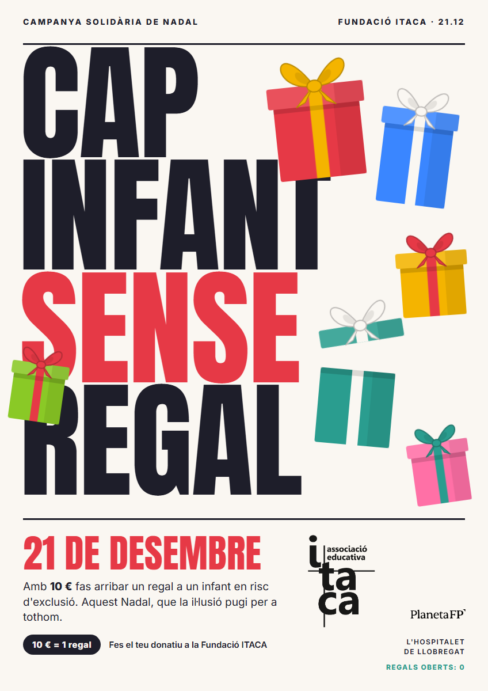

# Cap infant sense regal · Cartel interactivo

Actividad 0612 · *The Interactive Poster* — Desarrollo web en entorno cliente
Fundación ITACA · L'Hospitalet de Llobregat



## Concepto

Campaña de sensibilización para recoger donativos (10 € = 1 regalo) y comprar regalos de Navidad a niños y niñas en riesgo de exclusión. La fecha de la campaña es el **21 de diciembre**.

El cartel parte de un póster de *The Moving Poster* en el que unas letras suben desde abajo, se detienen, vuelven a subir y desaparecen en bucle. Aquí las letras se sustituyen por **regalos**: cajas de colores con lazo que salen de la franja inferior, se paran delante del titular **«CAP INFANT SENSE REGAL»** y siguen subiendo hasta perderse por arriba. Así queda la idea de que los regalos pasan por delante, pero no se quedan hasta que alguien los «abre».

- Formato: 848 × 1200 px (A3 vertical adaptado a pantalla). Se escala proporcionalmente si la ventana es más pequeña.
- Tipografías: *Anton* (titular y fecha) e *Inter* (textos), de Google Fonts.
- Branding: ITACA associació educativa y PlanetaFP (carpeta `img/`).

## Estructura

```
index.html   → estructura del cartel (titular, capa de regalos, franja inferior)
vendor/      → three.js y GLTFLoader
models/      → modelos .glb originales + models.js (versión optimizada en base64)
style.css    → maquetación 848×1200, tipografía, transiciones de la tapa y las chispas
main.js      → creación de los regalos, bucle de animación, interacciones y escalado
img/         → logotipos
screenshot.png
```

`main.js` está organizado por secciones: CONFIGURACIÓN → UTILIDADES → CREACIÓN DE REGALOS → BUCLE DE ANIMACIÓN → INTERACCIONES → CAPTURA → ESCALADO → INICIO.

## Animación en bucle

El bucle usa `requestAnimationFrame` (`loop()`), y cada regalo tiene una pequeña máquina de estados (`updateRise()`):

1. `wait`: espera un tiempo aleatorio debajo del cartel.
2. `rise1`: sube hasta una altura aleatoria con *ease-out* (frena).
3. `hold`: se queda parado 1,5 s.
4. `rise2`: vuelve a subir con *ease-in* (acelera), se desvanece por arriba y `resetGift()` lo devuelve abajo con otro aspecto.

## Regalos 3D y físicas de globo

Los regalos son modelos 3D (`models/*.glb`) dibujados con **three.js** en un único canvas WebGL transparente con cámara ortográfica (1 unidad = 1 px del cartel). Los `.glb` originales se han optimizado y se guardan en `models/models.js` como base64, así que el cartel funciona también abriendo `index.html` con doble clic. three.js y GLTFLoader están en `vendor/` (sin CDN).

Cada regalo se comporta como un globo:

1. Sale por debajo y flota hacia arriba con balanceo y giro lento.
2. Choca contra el borde superior, rebota un poco y aguanta **1 segundo** pegado al techo.
3. Se escapa flotando hacia arriba y vuelve a salir por abajo con otro modelo, tamaño y posición.
4. Rebotan entre sí y contra las paredes laterales.

## Interacciones

| Evento | Elemento | Función | Qué hace |
|---|---|---|---|
| `pointermove` | `#poster` | `handleMove()` | Guarda la posición y la velocidad del cursor. Al tocar un regalo, `applyMouse()` lo empuja según esa velocidad y lo hace girar. |
| `pointerdown` | `#poster` | `handlePoke()` | Un clic sobre un regalo lo lanza lejos del punto de contacto. |
| `pointerleave` | `#poster` | `stopMouse()` | Desactiva el empuje al salir del cartel. |
| `resize` | `window` | `fitPoster()` | Recalcula la escala y la resolución del canvas. |
| `keydown` (Espacio) | `window` | `freezeForCapture()` | Congela una composición fija para la captura. |

Los logos de ITACA y PlanetaFP son enlaces a [aeitaca.org](https://aeitaca.org) y [planetafp.es](https://www.planetafp.es).

## Cómo ejecutarlo

Abrir `index.html` en el navegador (doble clic o Live Server). No necesita ninguna dependencia.

- **Espacio**: congela o reanuda la composición final.
- `index.html?capture`: arranca directamente con la composición final. Se ha usado para generar `screenshot.png`.
