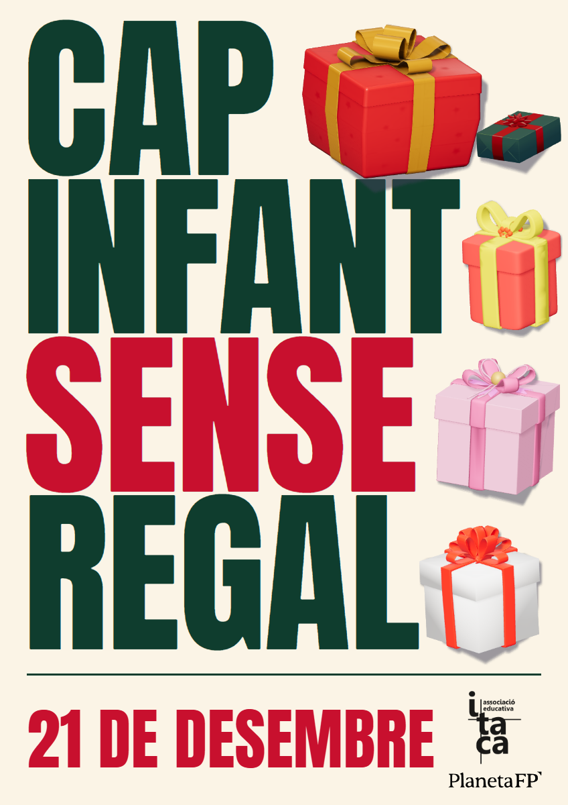

# Cap infant sense regal · Cartel interactivo

Actividad 0612 · *The Interactive Poster* — Desarrollo web en entorno cliente
Fundación ITACA · L'Hospitalet de Llobregat

| Estado inicial (antes de la animación) | Pantalla llena de regalos |
|---|---|
|  |  |

## Concepto

Campaña de sensibilización para recoger donativos (10 € = 1 regalo) y comprar regalos de Navidad a niños y niñas en riesgo de exclusión. La fecha de la campaña es el **21 de diciembre**.

El cartel parte de un póster de *The Moving Poster* en el que unas letras suben desde abajo, se detienen y desaparecen en bucle. Aquí las letras se sustituyen por **regalos 3D** y el titular **«CAP INFANT SENSE REGAL»** dialoga con ellos: los regalos suben como globos, **llenan la pantalla** y se marchan todos a la vez. Mientras la pantalla se llena, la palabra **«SENSE» desaparece**, y el titular queda leyéndose «CAP INFANT … REGAL».

- Formato: 848 × 1200 px (A3 vertical adaptado a pantalla). Se escala proporcionalmente si la ventana es más pequeña.
- Tipografía: *Anton* (titular y fecha), de Google Fonts.
- Paleta navideña: crema `#FBF4E6`, verde abeto `#0F3D2E`, rojo cereza `#C8102E` y dorado `#D4A017` (variables CSS en `style.css`).
- Branding: ITACA associació educativa y PlanetaFP, apilados y centrados en la franja inferior (carpeta `img/`). Cada logo es un enlace a su web.
- **Estado inicial**: el cartel se ve completo sin esperar a la animación, porque hay 5 regalos fijos de fondo en los huecos junto al titular.

## Estructura

```
index.html   → estructura del cartel (titular, capas de regalos y efectos, franja inferior)
style.css    → maquetación 848×1200, tipografía, paleta y animación de las letras de «SENSE»
main.js      → escena 3D, física, ciclo de la animación, interacciones y escalado
vendor/      → three.js (r147), GLTFLoader y RoomEnvironment (sin CDN)
models/      → modelos .glb originales + models.js (versión optimizada en base64)
img/         → logotipos
screenshot.png, screenshot-inicio.png
```

`main.js` está organizado por secciones: CONFIGURACIÓN (`CONFIG`) → ESTADO → UTILIDADES → ESCENA THREE.JS Y MODELOS → CREACIÓN DE REGALOS → FÍSICAS → INTERACCIONES → CAPTURA → ESCALADO → INICIO. Casi todos los números (cantidad de regalos, velocidades, tiempos, rebotes, sombras…) están en `CONFIG` al principio.

## Regalos 3D

Los regalos son modelos `.glb` dibujados con **three.js** en un único canvas WebGL transparente, con cámara ortográfica (1 unidad = 1 px del cartel). Los `.glb` originales se optimizaron (menos polígonos, texturas a 384–512 px en WebP) y se empaquetan en `models/models.js` como base64, así que el cartel funciona también abriendo `index.html` con doble clic, sin servidor.

- **9 modelos base**, más variantes de color de los que llevan textura: 16 plantillas en total.
- **Variedad de color**: cada vez que sale un regalo de color plano se le cambia el tono al azar (`tintModel`). Los modelos con textura tienen variantes pre-coloreadas (`_h120`, `_h200`…).
- **Regalos fijos de fondo** (`STATIC_GIFTS`): 5 regalos que no se mueven ni colisionan y quedan detrás de los que suben.

### Acabado realista

Aplicado solo a los regalos que suben (cada uno tiene sus propios materiales; `giftShading`):

- **Sombras**: sombra proyectada sobre el cartel (mapa de sombras 4096) y **sombras de contacto entre regalos** mediante oclusión ambiental analítica con esferas: donde un regalo toca o tapa a otro, se oscurece con un tono frío.
- **Contraluz** frío en los bordes (fresnel) y **gradación** de color: luces cálidas, sombras frías y más contraste.
- **Profundidad atmosférica**: los regalos pequeños (lejanos) se oscurecen y se desaturan un poco. No se usa ningún desenfoque.
- Entorno con iluminación basada en imagen (reflejos suaves) y *tone mapping* ACES.

## Ciclo de la animación

Todo el cartel sigue un ciclo en cuatro fases (`updateCycle()`):

1. **fill**: salen **37 regalos** en ráfaga, uno cada 0,07 s, por carriles de salida repartidos y barajados, y suben rápido apilándose desde el techo hasta llenar la pantalla. A los 1,8 s «SENSE» empieza a desaparecer letra a letra.
2. **full**: la pantalla se queda llena 2,6 s (se puede jugar con el ratón).
3. **release**: todos los regalos se escapan a la vez hacia arriba.
4. **pause**: 1,5 s con el cartel vacío; «SENSE» vuelve con un pequeño rebote y todo empieza de nuevo.

Cada regalo tiene un estado propio: `wait` → `rise` → `leave` → `gone`.

## Física

Hecha a mano (sin librerías) en `updateGift()`, `applyMouse()` y `collideGifts()`:

- **Flotación** tipo globo con turbulencia suave y rozamiento (lineal + cuadrático). Los pesados (más grandes) reaccionan menos.
- **Colisiones** entre regalos con separación por masa y rebote amortiguado; contra el techo y las paredes laterales.
- **Dinámica angular** con muelles amortiguados: balanceo, cabeceo y aplastamiento al chocar. El giro tiene fecha de caducidad (*ease-out* exponencial): los regalos acaban quietos.
- **Nunca hacia abajo**: el cursor y los choques no pueden empujar un regalo hacia abajo.
- Contactos nuevos frente a presión continua: el aplastamiento y los efectos solo se disparan en el primer golpe, no mientras el montón está en reposo.

## Interacciones

| Evento | Elemento | Función | Qué hace |
|---|---|---|---|
| `pointermove` | `#poster` | `handleMove()` | Guarda la posición y la velocidad del cursor. Al tocar un regalo, `applyMouse()` lo empuja según esa velocidad y lo hace girar. |
| `pointerdown` | `#poster` | `handlePoke()` | Un clic sobre un regalo lo lanza lejos del punto de contacto. |
| `pointerleave` | `#poster` | `stopMouse()` | Desactiva el empuje al salir del cartel. |
| `resize` | `window` | `fitPoster()` | Recalcula la escala y la resolución del canvas. |
| `keydown` (Espacio) | `window` | `freezeForCapture()` | Salta al instante al momento de pantalla llena y lo congela; otra pulsación reanuda. |

**Efectos de impacto** (`impactFx()`): al tocar un regalo con el ratón, al chocar dos regalos con fuerza o al hacer clic, salen unas rayas oscuras en abanico desde el punto de contacto (6 en círculo completo en los clics). El regalo además da un pequeño salto elástico.

**«SENSE» animada**: `splitSense()` parte la palabra en letras y `setSense()` cambia un atributo (`data-sense`) del cartel. Las transiciones CSS (`.headline .accent .ch`) hacen el resto, con un retraso de 70 ms entre letras.

Los logos de ITACA y PlanetaFP son enlaces a [aeitaca.org](https://aeitaca.org) y [planetafp.es](https://www.planetafp.es).

## Cómo ejecutarlo

Abrir `index.html` en el navegador (doble clic o Live Server). No necesita instalar nada. La tipografía se carga desde Google Fonts, así que hace falta conexión a internet.

- **Espacio**: salta a la pantalla llena y la congela, o reanuda.
- `index.html?capture`: arranca directamente en ese momento. Se ha usado para generar `screenshot.png`.
- Requiere WebGL (cualquier navegador moderno).

## Créditos

- Modelos 3D de regalos: varios autores de Sketchfab (las licencias de cada modelo están en `models/` cuando se incluyen; la carpeta `models/gift/` trae la suya en `license.txt`). Revisar las licencias antes de publicar.
- three.js (MIT) · Anton (SIL OFL).
